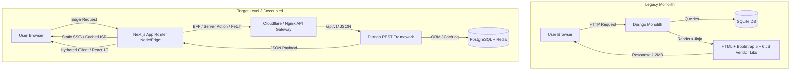
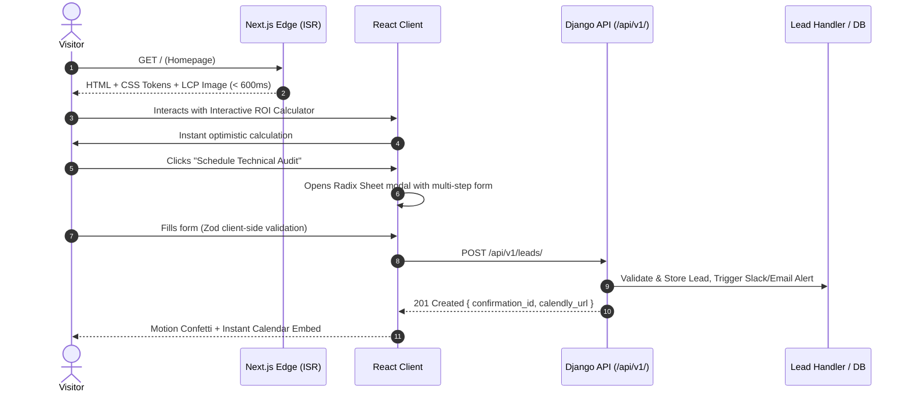
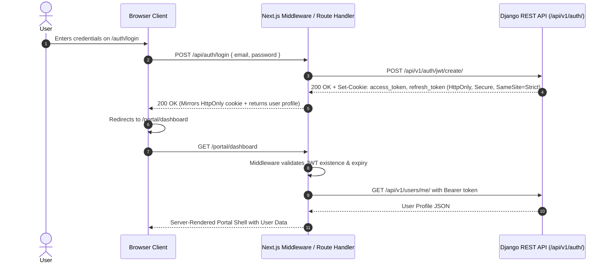
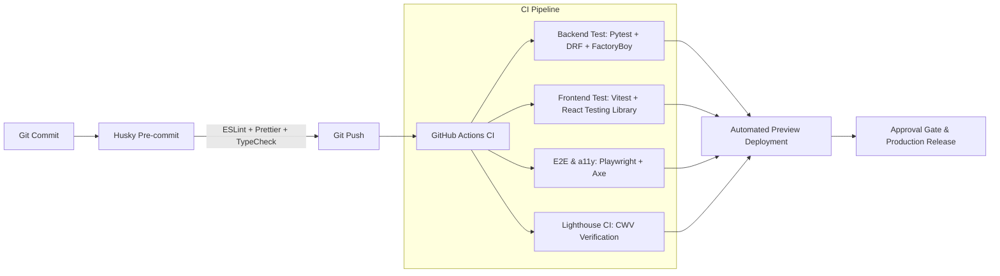

# Master Implementation Plan: Decoupled Enterprise Architecture (Level 3)

**Project**: GB Technologies Web Transformation  
**Role**: Principal Product Designer & Staff Full-Stack Engineer  
**Status**: Proposal & Architecture Blueprint (Pending User Approval)  
**Target Architecture**: Level 3 Decoupled — Django REST Framework Backend (`/api/v1/`) + Next.js 14/15 App Router Frontend (TypeScript, Tailwind CSS, shadcn/ui, Radix UI, Framer Motion)

---

## Executive Summary & Architectural Vision

The current `gb-technologies` repository is a monolithic Django 5.0.2 application using server-rendered templates, Bootstrap 5.3, vanilla JavaScript, and legacy jQuery/vanilla plugins (AOS, Isotope, GLightbox, Swiper, PureCounter). While functional, it couples backend business logic directly to HTML presentation, limits client-side interactivity, slows developer velocity, and suffers from styling debt and layout rigidity.

This master implementation plan outlines the engineering and design roadmap to transform `gb-technologies` into a **Level 3 Decoupled Enterprise Product**:
1. **Core Backend (Headless Django)**: Strips HTML rendering from Django, introducing Django REST Framework (DRF) + `drf-spectacular` for OpenAPI 3.1 schema generation, secure HTTP-only cookie JWT authentication (`dj-rest-auth` / SimpleJWT), strict CORS/CSRF boundaries, Redis caching, and granular rate-limiting.
2. **Next.js App Router (Frontend)**: A modern React 19 / Next.js 14/15 application written in strict TypeScript, styled with Tailwind CSS using an accessible OKLCH tokenized design system, composable shadcn/ui and Radix primitives, smooth Framer Motion micro-interactions, and end-to-end type safety via Zod and TanStack React Query v5.
3. **Zero-Downtime Strangler Migration**: A phased migration pattern orchestrated via Nginx / Cloudflare reverse proxy routing that incrementally replaces legacy Django template routes with Next.js edge-rendered routes without breaking active sessions or SEO authority.

---

## Part 1: Current Repository Audit & Gap Analysis

### 1.1 Complete Codebase Inventory

| Domain | File / Location | Current Implementation | Reusability / Assessment |
| :--- | :--- | :--- | :--- |
| **Django Settings** | `gb_technologies/settings.py` | Monolithic settings, `DEBUG=True`, SQLite local DB, local staticfiles storage, standard session middlewares. | **Modify**: Retain core Django security; add CORS headers, DRF configuration, JWT settings, REST framework pagination, and environment variable decoupling via `django-environ`. |
| **Root Routing** | `gb_technologies/urls.py` | Routes admin to `admin/`, app routes to `web.urls`. | **Modify**: Mount `/api/v1/` routes; attach OpenAPI schema and Swagger/Redoc endpoints (`/api/schema/`, `/api/docs/`). |
| **Apps** | `web`, `webint` | `web` contains all models, views, templates, and forms. `webint` is an empty skeleton app. | **Refactor**: Deprecate `webint` or repurpose as internal micro-service. Refactor `web` to house API views, serializers, model managers, and querysets. |
| **Data Models** | `web/models.py` | `UserProfile`: 1-to-1 relation with `django.contrib.auth.models.User`, `middlename`, `date_of_birth`, `phone_number`, `country`, `profile_image`. | **Keep & Extend**: Highly reusable. Add UUID primary keys or public IDs, audit timestamps (`created_at`, `updated_at`), soft deletes, and phone validator regex. |
| **Database Migrations** | `web/migrations/` | Initial profile migrations exist and are applied. | **Keep**: Maintain schema state; add new migrations for model enhancements. |
| **Views** | `web/views.py` | Template-rendering views (`landing`, `index`, `user_login`, `user_logout`, `register`, `profile_view`, `edit_profile`). Session authentication, `login_required` decorators, standard Django Form handling. | **Replace**: Deprecate template views in favor of DRF ViewSets / Generic API Views returning JSON payloads. |
| **Forms** | `web/forms.py` | `LoginForm`, `RegisterForm`, `EditProfileForm` (Django Forms with Bootstrap widget class injections). | **Replace**: Deprecate. Form validation will be handled on the frontend via Zod schemas and on the backend via DRF Serializers. |
| **URLs** | `web/urls.py` | `landing/`, `index/`, `logout/`, `profile/` active; `login/`, `register/`, `profile/edit/` commented out. | **Refactor**: Replaced by unified versioned REST endpoints (`/api/v1/auth/`, `/api/v1/users/me/`). |
| **Templates** | `web/templates/web/*.html` | `base.html`, `landing.html`, `index.html`, `login.html`, `register.html`, `profile.html`, `edit_profile.html`. Monolithic HTML with Jinja/Django tags. | **Technical Debt**: Decommission after Next.js pages reach feature parity. Serve as visual reference for layout extraction. |
| **Static Assets** | `web/static/assets/` | Monolithic asset directory: `css/main.css` (3,000+ lines of custom overrides), `vendor/bootstrap/`, `vendor/aos/`, `vendor/swiper/`, `vendor/glightbox/`, `vendor/isotope-layout/`, `vendor/purecounter/`. | **Technical Debt**: Heavy legacy bundle size (~1.2MB uncompressed). Decommission in favor of npm packages, Tailwind tree-shaking, and Lucide icons. |

### 1.2 Gap Analysis: Legacy Monolith vs. Target Decoupled State



---

## Part 2: Information Architecture & UX Redesign

### 2.1 Complete Sitemap & Route Taxonomy

```
gb-technologies.com
├── / (Marketing Homepage)
│   ├── Hero (Value Proposition, Interactive Product Demo, Social Proof)
│   ├── Solutions Matrix (Enterprise Architecture, Cloud Engineering, Cyber Resilience)
│   ├── Interactive Bento Grid (Platform Capabilities & Metrics)
│   ├── Client Success Stories & Testimonial Carousel
│   ├── Tech Ecosystem & Integrations Marquee
│   └── High-Conversion CTA Banner & Global Footer
├── /solutions (Solutions Overview)
│   ├── /solutions/cloud-infrastructure
│   ├── /solutions/data-intelligence
│   └── /solutions/enterprise-cybersecurity
├── /services (Service Delivery Catalog)
│   ├── /services/architecture-consulting
│   ├── /services/full-stack-modernization
│   └── /services/managed-devops
├── /case-studies (Customer Proof & Results)
│   ├── /case-studies/[slug] (Rich Case Study Template with Metrics & Architecture Diagrams)
├── /company (About, Team, Mission, ESG)
├── /contact (Interactive Project Scoping Form & Sales Booking)
├── /auth (Authentication Subsystem)
│   ├── /auth/login (Email/Password + WebAuthn/SSO, 2FA prompt)
│   ├── /auth/register (Multi-step Onboarding Wizard)
│   ├── /auth/forgot-password & /auth/reset-password
├── /portal (Protected Client & Account Portal)
│   ├── /portal/dashboard (Telemetry, Service Health, Active Engagements)
│   ├── /portal/profile (Personal Details, Security Keys, Contact Preferences)
│   ├── /portal/profile/edit (Modal & Dedicated Route with Optimistic Updates)
│   └── /portal/settings (Notification rules, API tokens, Audit Logs)
└── /legal
    ├── /legal/privacy-policy
    └── /legal/terms-of-service
```

### 2.2 Core User Flows

#### 1. Public Discovery to Qualified Lead Flow


#### 2. Authentication & Protected Session Flow (Secure HTTP-Only Cookie)


### 2.3 Wireframe & Layout Specifications

#### Top Page 1: Marketing Homepage (`/`)
* **Header / Navigation**: Fixed floating pill container with `backdrop-filter: blur(14px)`. Brand mark on left, dynamic navigation items in center (with animated hover pill indicator), "Portal Login" ghost button and "Book Consultation" glow CTA on right.
* **Hero Section**:
  * Dual-column layout on desktop (`lg:grid-cols-12`, 7/5 split).
  * Left: Micro-badge ("Announcing GB Enterprise 3.0"), Fluid Display H1 typography, lead paragraph with subtle muted contrast, dual CTA group with magnetic hover physics, and client trust logos marquee.
  * Right: Interactive Bento visualizer or simulated live cloud architecture telemetry card with live pulsing status indicators.
* **Capabilities Bento Grid**:
  * 3x2 asymmetrical grid (`grid-cols-1 md:grid-cols-3 md:grid-rows-2`).
  * Card 1 (Span 2x1): Enterprise Cloud Migration with live latency reduction simulator.
  * Card 2 (Span 1x1): 99.999% SLA Uptime Metric with animated radial gauge.
  * Card 3 (Span 1x1): Zero-Trust Architecture Security shield graphic.
  * Card 4 (Span 2x1): Global Microservices Mesh with interactive node map.
* **Proof & Testimonials**: Tabbed proof points with quantifiable metrics (+340% throughput, -42% cloud spend) paired with video case studies.
* **Footer**: 5-column navigation tree, newsletter signup with micro-validation, legal disclosures, system status indicator (green badge: "All Systems Operational").

#### Top Page 2: Protected Portal Dashboard (`/portal/dashboard`)
* **Shell**: Left collapsible sidebar (width 260px expanded, 72px collapsed) with intuitive icon navigation, breadcrumbs header with tenant selector, search command palette (`Cmd+K`), notification bell with badge counter, and user profile avatar dropdown.
* **Main Stage**:
  * KPI Metric Ribbon: 4 metric cards (Active Projects, System Health, API Usage, Open Support Tickets) featuring sparkline mini-charts and delta percentage indicators.
  * Activity Stream: Virtualized feed of security and infrastructure events with filtering by severity (Critical, Warning, Info).
  * Service Overview Table: Sortable, filterable TanStack Data Table displaying connected services, cloud regions, and uptime history.

#### Top Page 3: Profile & Security Management (`/portal/profile/edit`)
* **Two-Column Settings Layout**:
  * Left Nav: Sub-navigation (Personal Information, Security & 2FA, API Keys, Notifications, Billing).
  * Right Canvas:
    * Avatar upload card with drag-and-drop zone, instant canvas-based image crop, and upload progress bar.
    * Form section: Name fields, phone number with country-code autocomplete, timezone picker, and biography markdown editor.
    * Security card: Password reset with real-time entropy/strength meter, active session revocation table with geolocation and device badges.
    * Actions: Sticky bottom bar with "Discard Changes" and "Save Profile" buttons, including dirty-state tracking and optimistic feedback.

---

## Part 3: Backend API Architecture (Headless Django)

### 3.1 Recommended Framework: Django REST Framework + `drf-spectacular`
* **Choice**: Django REST Framework (DRF) is recommended over Django Ninja for this repository because the existing codebase already uses standard Django Models, ModelForms, and Django authentication infrastructure. DRF provides mature ecosystem packages: `dj-rest-auth`, `django-cors-headers`, `drf-spectacular` (OpenAPI 3.1), and `djangorestframework-simplejwt`.

### 3.2 Endpoint Specification (`/api/v1/`)

```
/api/v1/
├── auth/
│   ├── POST login/                -> Exchange email/password for JWT (sets HttpOnly cookies)
│   ├── POST logout/               -> Blacklist refresh token & clear cookies
│   ├── POST register/             -> Create User + UserProfile skeleton
│   ├── POST token/refresh/        -> Rotate access token via refresh token cookie
│   ├── POST password/reset/       -> Request password reset email
│   └── POST password/reset/confirm/ -> Apply new password via secure token
├── users/
│   ├── GET me/                    -> Get current authenticated user profile
│   ├── PATCH me/                  -> Update current user & profile fields
│   ├── POST me/avatar/            -> Multipart upload for profile image (WebP optimized)
│   └── DELETE me/                 -> Account deletion / GDPR anonymization
├── contact/
│   └── POST leads/                -> Submit enterprise contact / consultation request
├── services/
│   ├── GET /                      -> List all published service offerings
│   └── GET {slug}/                -> Get detailed service spec with capabilities & pricing
└── health/
    └── GET /                      -> Liveness & readiness probes (DB, Cache, Storage)
```

### 3.3 Detailed Schema & Serializer Architecture

#### `UserProfileSerializer` & `UserSerializer`
```python
# web/serializers.py
from rest_framework import serializers
from django.contrib.auth.models import User
from .models import UserProfile
import re

class UserProfileSerializer(serializers.ModelSerializer):
    profile_image_url = serializers.SerializerMethodField()

    class Meta:
        model = UserProfile
        fields = [
            'middlename',
            'date_of_birth',
            'phone_number',
            'country',
            'profile_image',
            'profile_image_url',
        ]
        read_only_fields = ['profile_image_url']

    def get_profile_image_url(self, obj):
        if obj.profile_image:
            request = self.context.get('request')
            return request.build_absolute_uri(obj.profile_image.url) if request else obj.profile_image.url
        return None

    def validate_phone_number(self, value):
        if value and not re.match(r'^\+?[1-9]\d{1,14}$', value):
            raise serializers.ValidationError("Enter a valid E.164 international phone number (e.g. +14155552671).")
        return value

class CurrentUserSerializer(serializers.ModelSerializer):
    profile = UserProfileSerializer()

    class Meta:
        model = User
        fields = ['id', 'username', 'email', 'first_name', 'last_name', 'is_staff', 'profile']
        read_only_fields = ['id', 'username', 'is_staff']

    def update(self, instance, validated_data):
        profile_data = validated_data.pop('profile', {})
        for attr, val in validated_data.items():
            setattr(instance, attr, val)
        instance.save()

        profile = instance.userprofile
        for attr, val in profile_data.items():
            setattr(profile, attr, val)
        profile.save()

        return instance
```

### 3.4 Authentication & Session Management Strategy
* **JWT in HTTP-Only Cookies**:
  * Access Token: 15-minute lifetime, stored in `__Host-access_token` cookie (`HttpOnly; Secure; SameSite=Strict; Path=/`).
  * Refresh Token: 7-day lifetime, stored in `__Host-refresh_token` cookie (`HttpOnly; Secure; SameSite=Strict; Path=/api/v1/auth/token/refresh/`).
  * Token Rotation & Blacklisting: Enabled via `rest_framework_simplejwt.token_blacklist`. Each token refresh issues a new refresh token and destroys the prior token.
* **CORS & CSRF Configuration**:
  ```python
  # settings.py additions
  INSTALLED_APPS += [
      'rest_framework',
      'rest_framework_simplejwt.token_blacklist',
      'corsheaders',
      'drf_spectacular',
  ]

  MIDDLEWARE = [
      'corsheaders.middleware.CorsMiddleware',
      'django.middleware.security.SecurityMiddleware',
      'django.contrib.sessions.middleware.SessionMiddleware',
      'django.middleware.common.CommonMiddleware',
      'django.middleware.csrf.CsrfViewMiddleware',
      # ...
  ]

  CORS_ALLOWED_ORIGINS = [
      "https://gb-technologies.com",
      "https://app.gb-technologies.com",
      "http://localhost:3000",
  ]
  CORS_ALLOW_CREDENTIALS = True
  CSRF_TRUSTED_ORIGINS = CORS_ALLOWED_ORIGINS
  ```

### 3.5 Rate Limiting & Throttling
* Anon Rate: `60/minute` on general endpoints; `5/minute` on `/api/v1/auth/*` to prevent credential stuffing.
* Authenticated Rate: `600/minute` per user ID.
* Backend Storage: Redis via `django-redis` cache backend.

---

## Part 4: Frontend Next.js Architecture

### 4.1 Technology Stack Selection
* **Framework**: Next.js 14.2+ or 15 (App Router, React 19 / Server Components).
* **Language**: TypeScript 5.5+ (Strict mode enabled, `noImplicitAny: true`).
* **Styling**: Tailwind CSS v4 with the OKLCH token system defined in `color_tokens.md` and `design_system.md`.
* **Component Library**: shadcn/ui built on Radix UI primitives.
* **Animation & Micro-interactions**: Framer Motion (or `motion/react`) with strict `prefers-reduced-motion` compliance.
* **Data Fetching & Cache**: TanStack React Query v5 for client state + Server Component native `fetch` with cache tagging.
* **Form Validation**: React Hook Form + Zod resolvers.
* **Icons**: `lucide-react`.

### 4.2 Project Directory Tree

```
frontend/
├── app/
│   ├── (marketing)/
│   │   ├── layout.tsx              # Sticky glass navbar, footer, marketing metadata
│   │   ├── page.tsx                # Homepage (Hero, Bento grid, Social proof)
│   │   ├── solutions/
│   │   │   └── page.tsx            # Solutions catalog
│   │   ├── services/
│   │   │   └── [slug]/page.tsx     # Dynamic service landing page (SSG + ISR)
│   │   ├── contact/
│   │   │   └── page.tsx            # Enterprise lead capture form
│   │   └── legal/
│   │       └── [slug]/page.tsx     # Terms & privacy policy
│   ├── (auth)/
│   │   ├── layout.tsx              # Centered card layout with ambient gradient background
│   │   ├── login/page.tsx          # Login form with WebAuthn/credentials
│   │   ├── register/page.tsx       # Registration wizard
│   │   └── forgot-password/page.tsx
│   ├── (portal)/
│   │   ├── layout.tsx              # Authenticated layout: Collapsible Sidebar, Header, Breadcrumbs
│   │   ├── dashboard/page.tsx      # Analytics, Active Engagements, Live Alerts
│   │   └── profile/
│   │       ├── page.tsx            # View User Profile
│   │       └── edit/page.tsx       # Edit Profile & Avatar upload
│   ├── api/                        # Next.js BFF (Backend for Frontend) proxy routes
│   │   ├── auth/[...route]/route.ts# Forwards auth cookies to Django API securely
│   │   └── revalidate/route.ts     # On-demand ISR revalidation hook
│   ├── global.css                  # Tailwind imports & OKLCH CSS variables
│   ├── layout.tsx                  # Root layout: Fonts, ThemeProvider, ToastProvider
│   ├── not-found.tsx               # Custom 404 page
│   └── error.tsx                   # Error boundary
├── components/
│   ├── ui/                         # shadcn/ui primitives (button, dialog, dropdown, input, etc.)
│   ├── marketing/                  # BentoGrid, HeroSection, TestimonialCarousel, PricingCalculator
│   ├── portal/                     # MetricCard, ActivityTable, AvatarUpload, SessionList
│   └── shared/                     # Navbar, Footer, ThemeToggle, BrandLogo, CommandMenu
├── hooks/
│   ├── use-auth.ts                 # Auth context / hook using React Query
│   ├── use-theme.ts                # Light / Dark / System theme manager
│   └── use-media-query.ts          # Responsive breakpoint listener
├── lib/
│   ├── api-client.ts               # Axios / Fetch client with automatic cookie forwarding & retry
│   ├── env.ts                      # T3-env / Zod validated environment variables
│   ├── tokens.ts                   # Token constants matching color_tokens.md
│   └── utils.ts                    # cn() helper (clsx + tailwind-merge)
├── types/
│   ├── api.ts                      # TypeScript interfaces generated from OpenAPI spec
│   └── user.ts                     # User & UserProfile types
└── schemas/
    ├── auth.schema.ts              # Zod schemas for Login & Registration
    └── profile.schema.ts           # Zod schema for Profile updates
```

### 4.3 Rendering Strategy Breakdown

| Route | Rendering Strategy | Revalidation / Invalidation | Justification |
| :--- | :--- | :--- | :--- |
| `/` (Homepage) | **SSG + ISR** | `revalidate: 3600` (1 hr) or on-demand webhook | Maximum Core Web Vitals speed (TTFB < 80ms), CDN cached at edge. |
| `/solutions/*`, `/services/*` | **SSG + ISR** | `revalidate: 86400` (24 hr) | Content updates rarely; pre-rendered for SEO indexing. |
| `/contact` | **SSG (Static Shell)** | Static prerender | Instant load; form submissions dispatched via client mutation to `/api/v1/contact/leads/`. |
| `/portal/dashboard` | **Dynamic SSR + Client Cache** | `no-store` at edge, TanStack Query cached client-side | Dynamic user-specific data; protected by Next.js middleware JWT check. |
| `/portal/profile/edit` | **Client-Hydrated SPA Route** | TanStack Query (`staleTime: 60s`) | Highly interactive form with dirty states, file uploads, and optimistic UI updates. |

### 4.4 Form Validation & State Architecture (Zod Schema Sample)

```typescript
// schemas/profile.schema.ts
import { z } from 'zod';

export const editProfileSchema = z.object({
  first_name: z.string().min(1, 'First name is required').max(50),
  last_name: z.string().min(1, 'Last name is required').max(50),
  middlename: z.string().max(50).optional().or(z.literal('')),
  date_of_birth: z.string().regex(/^\d{4}-\d{2}-\d{2}$/, 'Format must be YYYY-MM-DD').optional().nullable(),
  phone_number: z.string()
    .regex(/^\+?[1-9]\d{1,14}$/, 'Must be a valid international phone number (e.g. +14155552671)')
    .optional()
    .or(z.literal('')),
  country: z.string().min(2, 'Please select a valid country').max(100),
  profile_image: z.instanceof(File).optional().nullable(),
});

export type EditProfileFormData = z.infer<typeof editProfileSchema>;
```

---

## Part 5: Performance, Security & Quality Engineering

### 5.1 Core Web Vitals Budget & Optimization

| Metric | Target (Mobile & Desktop) | Optimization Techniques |
| :--- | :--- | :--- |
| **LCP (Largest Contentful Paint)** | `< 1.2s` (Desktop), `< 1.8s` (Mobile) | Next.js `<Image priority fetchPriority="high">`, AVIF/WebP image transcoding, preloaded critical font subsets. |
| **INP (Interaction to Next Paint)** | `< 100ms` | Zero heavy synchronous JS on main thread, debounced handlers, CSS-driven hover states, Framer Motion hardware-accelerated transforms. |
| **CLS (Cumulative Layout Shift)** | `0.00` | Explicit width/height reservations on all media, font-display: optional with matched fallback metric overrides, reserved skeleton layouts. |
| **FCP (First Contentful Paint)** | `< 0.8s` | Inline critical CSS tokens, zero render-blocking third-party scripts. |
| **Bundle Size Budget** | `< 120kB` First Load JS | Next.js automatic route code splitting, dynamic imports for modals and heavy charts (`next/dynamic`). |

### 5.2 Security Architecture

* **Content Security Policy (CSP)**:
  ```http
  Content-Security-Policy: default-src 'self'; script-src 'self' 'unsafe-eval' https://challenges.cloudflare.com; style-src 'self' 'unsafe-inline'; img-src 'self' data: https://blob.gb-technologies.com; font-src 'self'; connect-src 'self' https://api.gb-technologies.com; frame-ancestors 'none';
  ```
* **Strict Transport Security**: `max-age=63072000; includeSubDomains; preload`.
* **Cookie Defenses**: `__Host-` prefix on auth cookies ensuring origin-bound, secure, path-restricted storage.
* **Input Sanitization**: DRF serializer validation paired with Bleach HTML striping on the backend; DOMPurify on any client-rendered rich text.

### 5.3 Accessibility & WCAG 2.2 AA Compliance Plan

* **Screen Reader Announcers**: Live regions (`aria-live="polite"`) for form errors, toast alerts, and dynamic filtering results.
* **Keyboard Navigation**:
  * Focus Visible indicators: `outline: 2px solid oklch(0.68 0.19 195)` with `outline-offset: 2px` across all interactive elements.
  * Trap focus within dialogs, sheets, and mobile drawers via Radix UI primitives.
  * Skip-to-content bypass link on all pages.
* **Contrast Compliance**: Strict validation against the matrix defined in `color_tokens.md` (minimum 4.5:1 for body copy, 3:1 for large headers and UI controls).
* **Automated Accessibility Testing**: `@axe-core/playwright` integrated into the CI/CD pipeline blocking PR merges on any critical or serious violations.

### 5.4 Testing Matrix & Quality Gates



---

## Part 6: Risk Register & Contingency Architecture

| Risk ID | Description | Severity | Likelihood | Mitigation Strategy |
| :--- | :--- | :--- | :--- | :--- |
| **R-01** | **CORS / Cookie Misconfiguration** between Next.js domain (`gb-technologies.com`) and Django API (`api.gb-technologies.com`). | High | Medium | Use top-level cookie domain scope (`.gb-technologies.com`) or route through Next.js BFF proxy `/api/v1/` on the exact same origin. |
| **R-02** | **Session Drift / Split-Brain Auth** during Strangler migration when some pages live on Django and others on Next.js. | High | Medium | Unify session store: Django authenticates using JWT cookies readable by both Django middleware and Next.js server middleware. |
| **R-03** | **SEO Drop during Route Migration**. | High | Low | Implement automated 301 redirect map at the reverse proxy layer. Preserve exact canonical URLs and metadata tags. |
| **R-04** | **Legacy Media URL Broken Links** (`/media/profile_images/*`). | Medium | Low | Configure cloud object storage (AWS S3 / Cloudflare R2) as single source of truth for media, accessible with stable CDN URLs. |
| **R-05** | **Performance Regressions on Next.js Hydration**. | Medium | Medium | Implement React Server Components for all static presentation widgets; limit `"use client"` directives strictly to leaf controls. |

---
*End of Master Implementation Plan. Proceed to review `migration_roadmap.md` for phase-by-phase execution schedules and the First 10 Tasks.*
