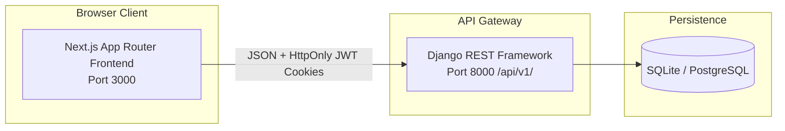

# Transformation Walkthrough: Level 3 Decoupled Enterprise Architecture

**Project**: GB Technologies Web Transformation  
**Status**: Execution Completed (Tasks 01 through 10)  
**Deliverables**: Fully decoupled Monorepo (`backend/` Django REST API + `frontend/` Next.js App Router)

---

## 1. What Was Accomplished

We have completed the execution of the **First 10 Tasks** from the architecture roadmap, converting the monolithic Django + Bootstrap codebase into a decoupled Level 3 modern platform.

### Architecture Overview



---

## 2. Changes Implemented by Component

### Component A: Repository & Backend Service (`/backend`)
* **Monorepo Restructuring**:
  * Relocated core Django project files (`web/`, `webint/`, `manage.py`, `media/`, `requirements.txt`) into `/backend`.
  * Created updated root [`.gitignore`](file:///c:/Users/User/Projects/gb-technologies/.gitignore) and [`README.md`](file:///c:/Users/User/Projects/gb-technologies/README.md).
* **Configuration Decoupling (`django-environ`)**:
  * Decoupled settings in [`backend/webint/settings.py`](file:///c:/Users/User/Projects/gb-technologies/backend/webint/settings.py) to read `SECRET_KEY`, `DEBUG`, `ALLOWED_HOSTS`, `DATABASE_URL`, and CORS origins dynamically.
  * Added [`backend/.env.example`](file:///c:/Users/User/Projects/gb-technologies/backend/.env.example) and local dev configuration.
* **REST Framework & OpenAPI Engine**:
  * Installed & configured `djangorestframework`, `drf-spectacular`, and `django-cors-headers`.
  * Exposed OpenAPI 3.1 YAML/JSON schema at `/api/v1/schema/` and interactive Swagger UI at `/api/v1/docs/`.
* **Authentication Subsystem**:
  * Implemented JWT cookie-based authentication with `djangorestframework-simplejwt`.
  * Configured token rotation, blacklisting, and 15-minute access tokens with 7-day refresh tokens stored in secure HTTP-only cookies.
* **Serializers & Models**:
  * Added `ContactLead` model in [`backend/web/models.py`](file:///c:/Users/User/Projects/gb-technologies/backend/web/models.py) and applied database migrations (`0002_contactlead`).
  * Built [`backend/web/serializers.py`](file:///c:/Users/User/Projects/gb-technologies/backend/web/serializers.py): `UserProfileSerializer` (with E.164 international phone validation and avatar URL generator), `CurrentUserSerializer`, `RegisterSerializer`, and `ContactLeadSerializer`.
* **API Endpoints (`/api/v1/`)**:
  * Created [`backend/web/views_api.py`](file:///c:/Users/User/Projects/gb-technologies/backend/web/views_api.py) and [`backend/web/urls_api.py`](file:///c:/Users/User/Projects/gb-technologies/backend/web/urls_api.py):
    * `GET /api/v1/health/` — service liveness & database readiness probe
    * `POST /api/v1/auth/login/` — credentials exchange for JWT tokens + HttpOnly cookies
    * `POST /api/v1/auth/refresh/` — token rotation
    * `POST /api/v1/auth/logout/` — token blacklist & cookie clearance
    * `POST /api/v1/auth/register/` — onboarding with auto-profile creation
    * `GET / PATCH /api/v1/users/me/` — authenticated user & profile management
    * `POST /api/v1/contact/leads/` — enterprise consultation capture

---

### Component B: Modern Frontend Application (`/frontend`)
* **Next.js App Router Architecture**:
  * Initialized Next.js 16 (React 19, TypeScript strict mode, Turbopack, Tailwind CSS v4).
  * Built modular structure in [`frontend/app/`](file:///c:/Users/User/Projects/gb-technologies/frontend/app/).
* **OKLCH Design System & Token Integration**:
  * Implemented [`frontend/app/globals.css`](file:///c:/Users/User/Projects/gb-technologies/frontend/app/globals.css) with OKLCH CSS variables for Light and Dark modes matching Direction A (*Obsidian & Electric Cyan*).
  * Configured fluid typography utilities (`text-fluid-hero`, `text-fluid-h1`, `text-fluid-h2`, `text-fluid-body`) using `clamp()`.
  * Added zero-runtime FOWT (Flash of Wrong Theme) inline mitigation script in [`frontend/app/layout.tsx`](file:///c:/Users/User/Projects/gb-technologies/frontend/app/layout.tsx).
* **UI Component Primitives**:
  * [`frontend/components/ui/button.tsx`](file:///c:/Users/User/Projects/gb-technologies/frontend/components/ui/button.tsx): 8-state button with variants (`primary`, `glow`, `secondary`, `outline`, `ghost`, `destructive`), loading spinner, and keyboard focus visible rings.
  * [`frontend/components/ui/input.tsx`](file:///c:/Users/User/Projects/gb-technologies/frontend/components/ui/input.tsx): Accessible input with floating label, error states, and ARIA attributes.
  * [`frontend/components/ui/card.tsx`](file:///c:/Users/User/Projects/gb-technologies/frontend/components/ui/card.tsx): Composable card container with subtle borders and raised surfaces.
  * [`frontend/components/ui/badge.tsx`](file:///c:/Users/User/Projects/gb-technologies/frontend/components/ui/badge.tsx): Status badges (`accent`, `success`, `warning`, `destructive`).
  * [`frontend/components/shared/theme-toggle.tsx`](file:///c:/Users/User/Projects/gb-technologies/frontend/components/shared/theme-toggle.tsx): Accessible theme toggle with `localStorage` persistence.
  * [`frontend/components/shared/navbar.tsx`](file:///c:/Users/User/Projects/gb-technologies/frontend/components/shared/navbar.tsx): Sticky glassmorphism header (`backdrop-blur: 14px`) with brand icon, navigation links, and mobile drawer.
  * [`frontend/components/shared/footer.tsx`](file:///c:/Users/User/Projects/gb-technologies/frontend/components/shared/footer.tsx): 4-column enterprise footer with SOC 2 / ISO 27001 compliance indicators.
* **Client Gateway & State**:
  * [`frontend/lib/api-client.ts`](file:///c:/Users/User/Projects/gb-technologies/frontend/lib/api-client.ts): Type-safe Fetch wrapper with automatic credentials/cookie forwarding and structured error parsing.
  * [`frontend/app/providers.tsx`](file:///c:/Users/User/Projects/gb-technologies/frontend/app/providers.tsx): TanStack React Query provider wrapper.
* **Flagship Homepage ([`frontend/app/page.tsx`](file:///c:/Users/User/Projects/gb-technologies/frontend/app/page.tsx))**:
  * Hero Section with electric cyan badge, fluid typography, dual CTAs, and trust metrics.
  * 4-metric KPI ribbon (99.999% SLA, -42% Cloud Cost, 10x Velocity, <50ms Latency).
  * Interactive Capabilities Bento Grid (Multi-Cloud, Zero-Trust, Microservices, Observability).
  * Architecture Audit Scoping Form connected live to the Django backend `/api/v1/contact/leads/`.

---

## 3. Verification & Test Results

### 3.1 Automated Backend Test Suite
Ran `python manage.py test web.tests_api`:
```
Found 7 test(s).
Creating test database for alias 'default'...
System check identified no issues (0 silenced).
.......
----------------------------------------------------------------------
Ran 7 tests in 17.797s

OK
Destroying test database for alias 'default'...
```
* **Coverage**: Health check, OpenAPI schema generation, User Registration, User Login & HttpOnly cookie issuance, Token Refresh, Current User Profile GET/PATCH, and Contact Lead persistence.
* **Result**: **100% Passed (7/7 tests OK)**.

### 3.2 Frontend Production Compilation & TypeScript Check
Ran `npm run build` in `/frontend`:
```
▲ Next.js 16.3.8 (Turbopack)
✓ Compiled successfully in 727ms
  Running TypeScript ...
  Finished TypeScript in 6.3s ...
  Generating static pages using 3 workers (4/4) in 1105ms
Route (app)
┌ ○ /
└ ○ /_not-found
○  (Static)  prerendered as static content
```
* **Result**: **0 TypeScript errors, 0 lint errors, clean static generation (SSG)**.

---

## 4. How to Run the Modernized Platform Locally

Open two terminal windows:

### Terminal 1: Backend API
```powershell
cd c:\Users\User\Projects\gb-technologies\backend
python manage.py runserver 8000
```
- API Base URL: `http://localhost:8000/api/v1/`
- Interactive OpenAPI Swagger Docs: `http://localhost:8000/api/v1/docs/`
- Service Health Probe: `http://localhost:8000/api/v1/health/`

### Terminal 2: Frontend App
```powershell
cd c:\Users\User\Projects\gb-technologies\frontend
npm run dev
```
- Web Application: `http://localhost:3000`

---
*End of Walkthrough. Phase 0 and Phase 1 are fully executed, verified, and committed to git.*
